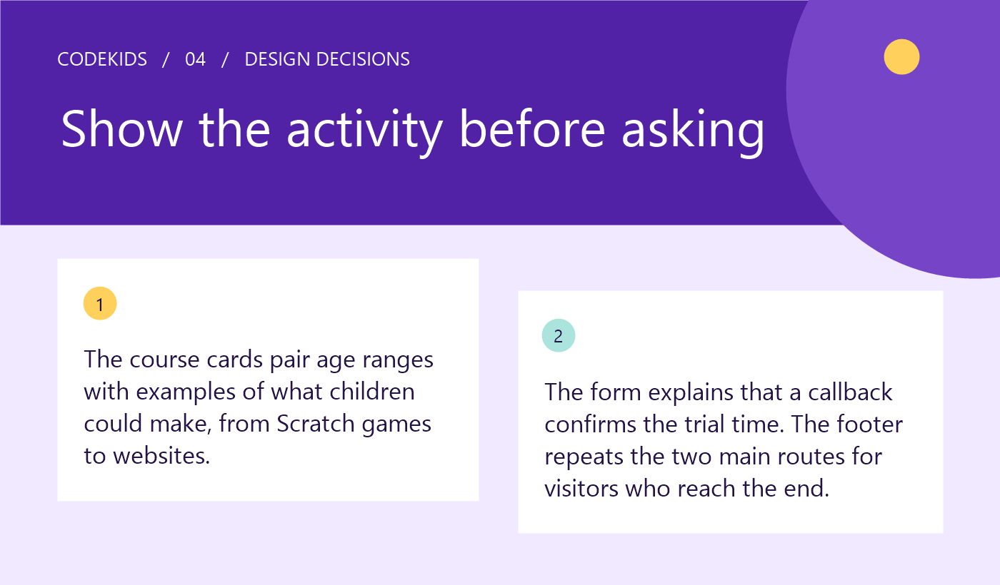

# CodeKids | Kids' Coding School Landing Page Concept

A self-initiated UI/UX design concept by **Ahasanul Karim Khan**, created in Figma as a **1440 px desktop landing page**.

[View the CodeKids case study on Behance](https://www.behance.net/gallery/257050573/CodeKids-Kids-Coding-School-Landing-Page-Concept)

## Overview

CodeKids explores two decisions for parents considering children's coding classes: which course fits their child, and whether to request a trial. The page introduces the program, compares courses and ends with a trial request.

## My contribution

- Designed the desktop landing-page composition in Figma.
- Organized Scratch, Python and web development course paths around age ranges and example activities.
- Placed trial-request actions along the page and designed a form with persistent parent-name and contact labels.
- Revised the trial wording to explain that a callback is the next step to confirm a time.
- Included program and trial-request routes in the footer.

## Design decisions

| Decision | Intent |
| --- | --- |
| Pair age ranges with example activities | Give parents concrete criteria for comparing course paths. |
| Introduce courses before the closing request | Let parents consider course fit before sharing contact details. |
| Explain the callback beside the form | Distinguish requesting a trial from confirming a booked time. |
| Keep labels visible above inputs | Preserve the meaning of each field when a value is entered. |
| Repeat program and trial routes in the footer | Offer a next step to visitors who reach the end of the page. |

These are design intentions, not measured improvements. See [design notes](docs/design-decisions.md) for scope and limitations.

## Selected preview

The selected panels are photo-free presentation excerpts. They explain part of the design story rather than showing the complete landing page. See [asset notes](docs/assets.md) for selection details.

## Project scope

Desktop landing-page design in Figma. This repository contains portfolio documentation and selected PNG previews. Mobile and tablet designs, application code, a functioning request form and a deployed service are outside this project package.

This is a concept project. Course content, prices, contact details and service copy shown in the original design are illustrative unless separately verified. No client engagement, user research, usability testing, launch, enrollment results or business-impact results are claimed.

## Designer

[Ahasanul Karim Khan on Behance](https://www.behance.net/ahasanulkarim1808) · [GitHub](https://github.com/ahasanulkarimkhan-uiux)

No open-source license is granted by this repository.
