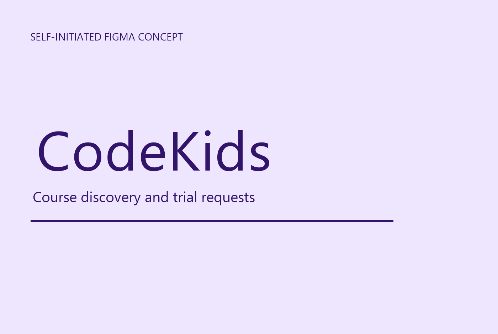

# CodeKids | Responsive coding-course landing page concept

[Open the live executable prototype](https://ahasanulkarimkhan-uiux.github.io/codekids-design/) · [View the Behance case study](https://www.behance.net/gallery/257050573/CodeKids-Kids-Coding-School-Landing-Page-Concept) · [Review the design tokens](docs/tokens.md)

CodeKids is a self-initiated portfolio concept for a parent or guardian comparing children's coding courses and deciding whether to request a trial. The responsive prototype follows the latest 1440 px Figma direction while adding explicit tablet, mobile, accessibility and local form states.

## What the prototype demonstrates

- Course comparison by age guidance, learning focus, projects and duration.
- Responsive behavior at desktop, tablet and narrow mobile widths.
- Mobile navigation, skip link, visible keyboard focus and 44 px minimum controls.
- Trial form default, validation-error and local-success states.
- No backend, account, payment, enrollment or real booking.

## Source and evidence boundaries

The visual direction comes from Figma frame `Page 1 / 1:2`, inspected on 7 November 2026. Fredoka, Nunito, exact source colors, radii and major dimensions are recorded in [tokens.md](docs/tokens.md). Public implementation imagery is CSS-built because source photography redistribution rights were not verified. Claims and prices that could be read as production evidence are omitted or reframed.

The form never transmits data. Submitting it only changes the current page to a local confirmation state.

## Project documentation

- [Approved brief](docs/brief-v3.md)
- [Critique and three-lens synthesis](docs/critique-notes.md)
- [Journey and information architecture](docs/ia-map.md)
- [Executable tasks](docs/tasks.md)
- [Protective UX and state coverage](docs/build-notes.md)
- [Rendered responsive audit](docs/rendered-audit.md)
- [Asset rights notes](docs/assets.md)

## Run locally

Open `index.html` directly. No build step, package manager or server is required.

## Designer

[Ahasanul Karim Khan on Behance](https://www.behance.net/ahasanulkarim1808) · [GitHub profile](https://github.com/ahasanulkarimkhan-uiux)

No open-source license is granted by this repository.
